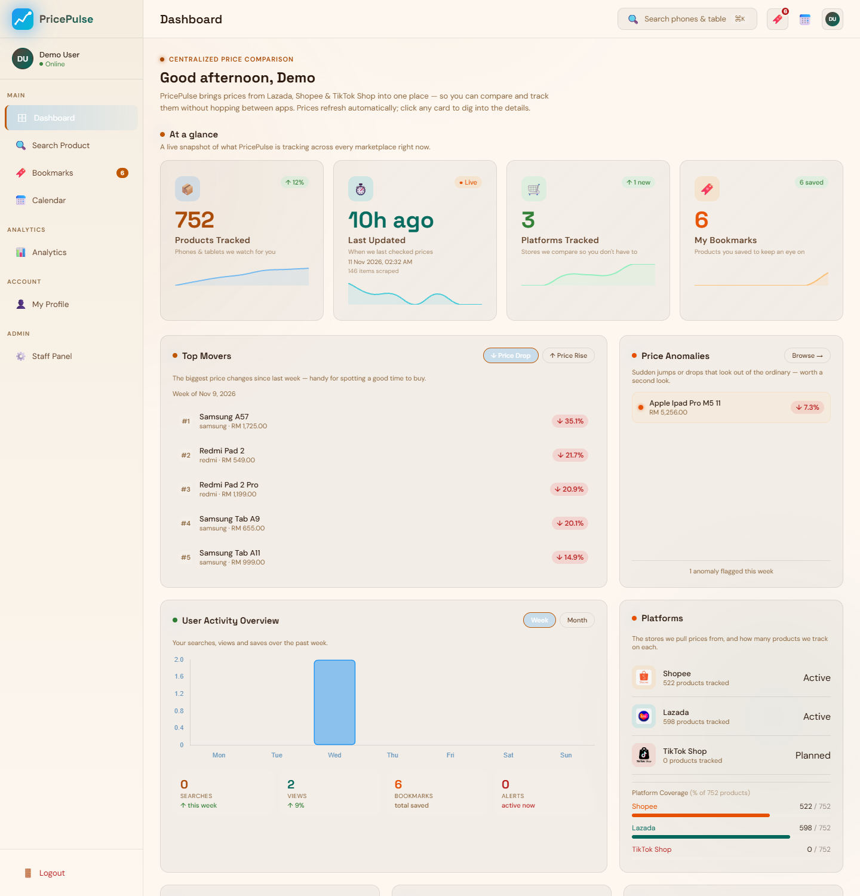
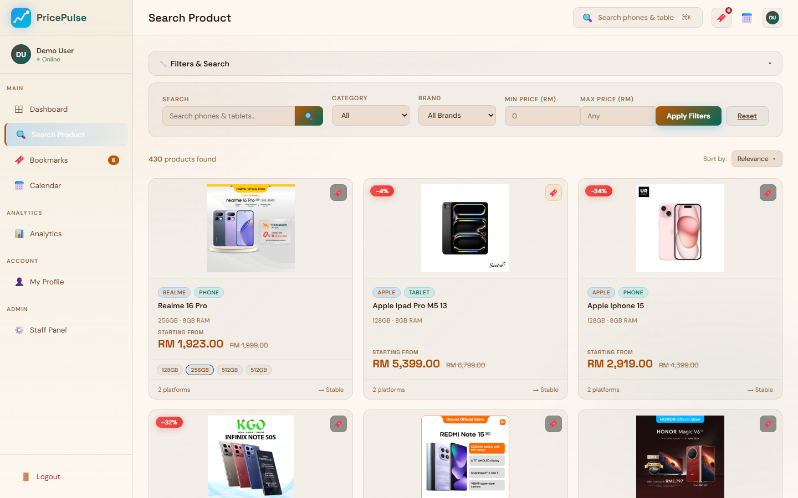
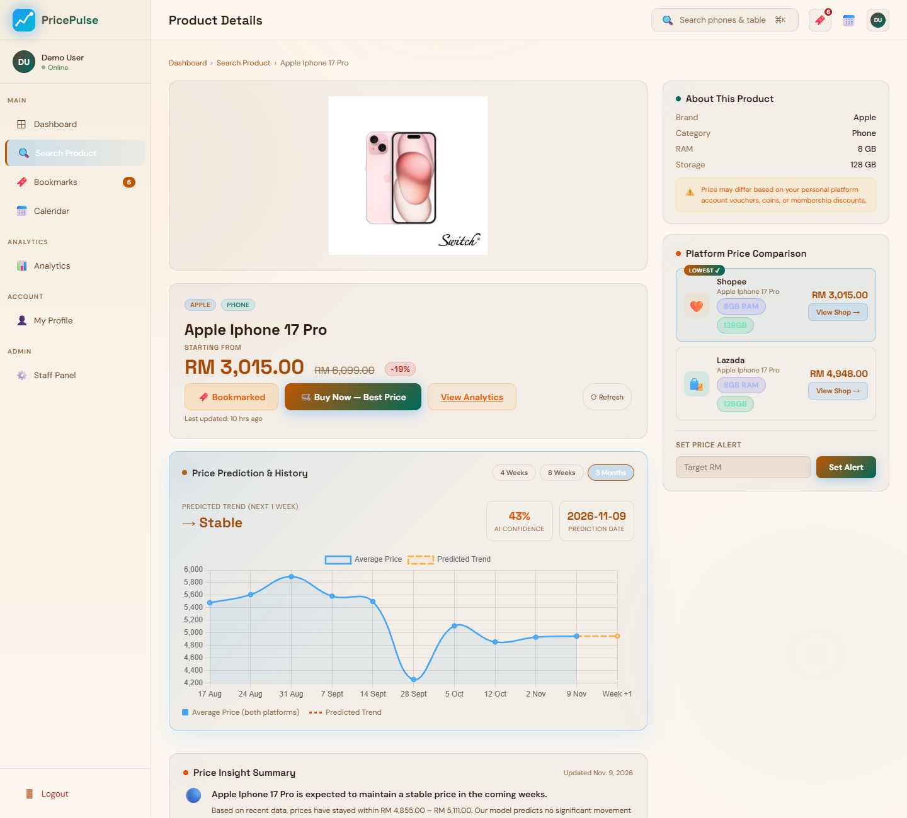
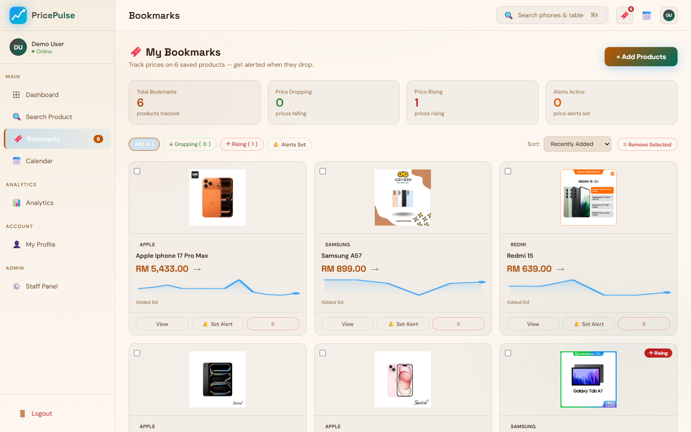
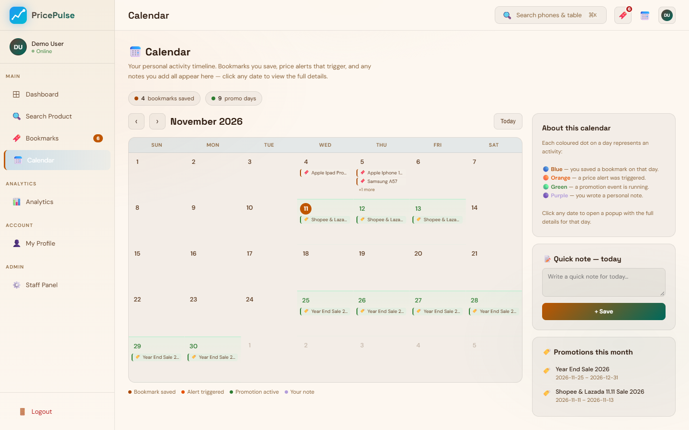
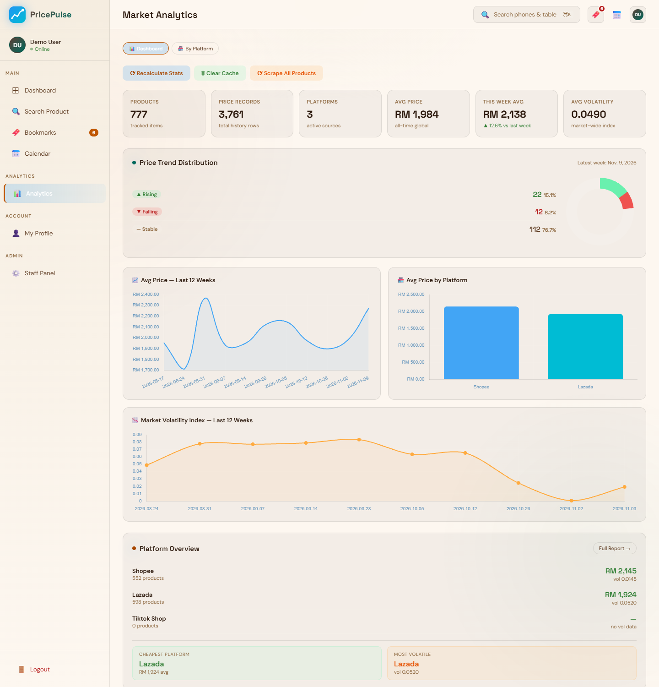
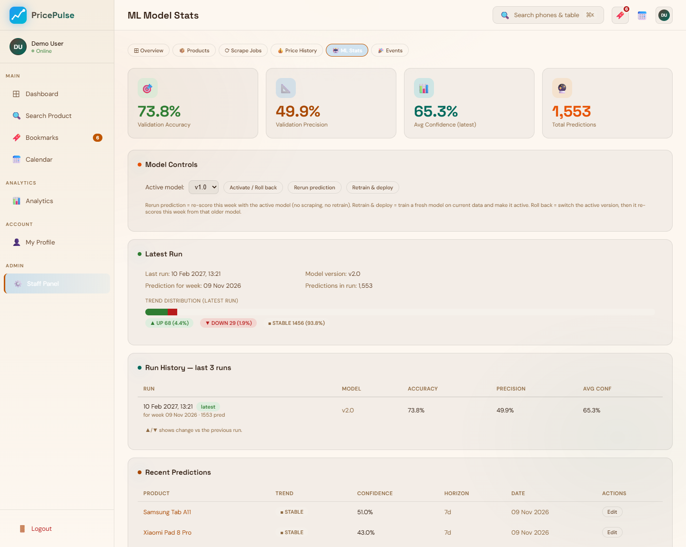
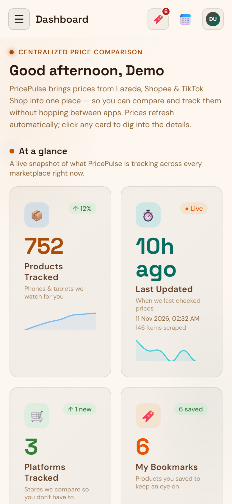
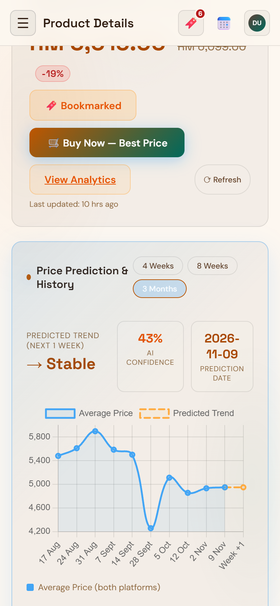
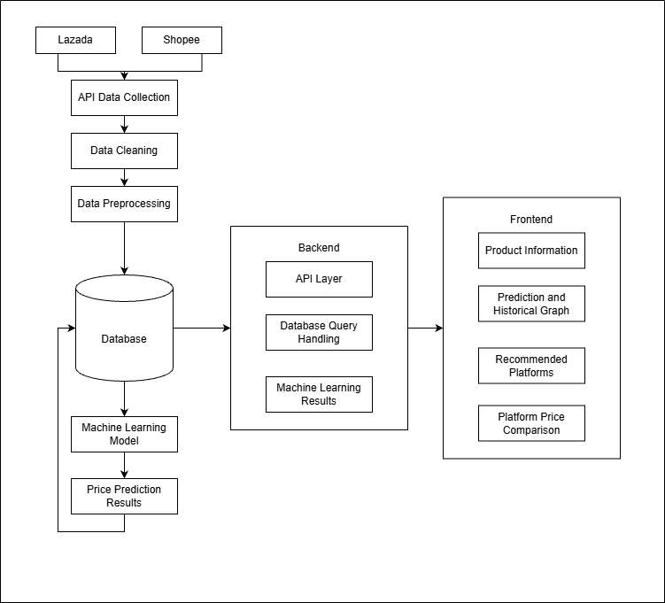

<p align="center">
  
</p>

<h1 align="center">PricePulse</h1>

<p align="center">
  Price tracking and next-week trend prediction for phones and tablets across Malaysian e-commerce platforms.
  <br>
  <a href="https://adfdzly.github.io/PricePulse-showcase/"><strong>Open the live demo</strong></a>
  &middot;
  <a href="docs/ARCHITECTURE.md">Architecture</a>
  &middot;
  <a href="docs/ML.md">ML write-up</a>
</p>

<p align="center">
  
</p>

> **About this repository.** PricePulse is a private project. This repo is a public showcase
> with screenshots, design documentation and a clickable demo. It does not contain the
> application source, scrapers, trained models, credentials or any collected marketplace data.
> The demo runs entirely in the browser on synthetic data.

## What it does

Shoppers in Malaysia often see the same phone listed at very different prices on Lazada
and Shopee, and prices swing around sale events like 11.11 and 12.12.
PricePulse collects those listings every week, matches them to a single product, and answers
three questions:

1. **Where is it cheapest right now?** It compares platforms side by side and highlights the lowest listing.
2. **How has the price moved?** It shows weekly price history per platform, all-time lows and how far the current price sits from its average.
3. **Will it be cheaper next week?** A Random Forest model predicts UP, DOWN or STABLE with a confidence score.

Users can bookmark products, set a target price and get an email when the price falls to it.

## Features

| Area | Highlights |
|---|---|
| Search and discovery | Keyword search with autocomplete, filters for brand, category, price range and predicted trend, multiple sort orders |
| Product intelligence | Lowest price across platforms, per-platform price history chart, all-time low, spread between platforms, next-week prediction with confidence |
| Bookmarks and alerts | Save products, set target prices, email notification after each pipeline run |
| Dashboard | Platform price index, biggest weekly movers, trend distribution, brand-by-week movement heatmap |
| Promotion calendar | Sale events, triggered alerts and personal notes in one calendar |
| Staff panel | Pipeline job monitor, product and price management, model retrain, version switch and rollback |
| Mobile app | React Native (Expo) client using the same REST API with JWT auth |

## Screenshots

| Search | Product detail |
|---|---|
|  |  |
| **Bookmarks and alerts** | **Promotion calendar** |
|  |  |
| **Market analytics** | **ML model stats (staff panel)** |
|  |  |

<p align="center">
  
  &nbsp;&nbsp;
  
</p>

Screenshots are from the real application running locally on a snapshot of collected
Lazada and Shopee data. The account is shown as "Demo User". The staff ML page reports the
stored validation metrics of the latest training run; [docs/ML.md](docs/ML.md) covers the
stricter walk-forward evaluation.

## How it works



**Data pipeline.** Product listings are collected from Lazada and Shopee through their
scraping APIs, then cleaned and preprocessed. Cleaning normalises titles and extracts brand,
RAM and storage so the same phone from both platforms maps to one product. Preprocessing
rolls listings up into weekly statistics and engineered features. Everything is stored in
MySQL.

**Machine learning loop.** The trend model reads weekly statistics from the database,
predicts next week's price direction for each product, and writes the prediction results
back to the database. A Celery schedule repeats this every week.

**Backend.** Django provides the API layer, handles database queries (with Redis caching
and throttling), and serves the stored machine learning results.

**Frontend.** The web app and the React Native app present product information, prediction
and historical price graphs, recommended platforms, and platform price comparison.

More detail is in [docs/ARCHITECTURE.md](docs/ARCHITECTURE.md).

## Machine learning in brief

- **Task:** 3-class classification of next week's lowest-price move (UP, DOWN or STABLE).
- **Model:** Random Forest with `balanced_subsample` class weights, wrapped in a confidence threshold that sends uncertain UP and DOWN calls back to STABLE.
- **Features:** 28, covering price levels, lags, rolling statistics, momentum, volatility, listing activity and category z-scores.
- **Label band:** each training run picks the move threshold automatically, with a guard that keeps UP and DOWN meaningful.
- **Operations:** models are versioned. Staff can retrain, re-score, or roll back to an earlier version from the admin panel.

Weekly prices are mostly flat, which makes accuracy a misleading headline: a model that
always says STABLE scores about 76%. The write-up in [docs/ML.md](docs/ML.md) compares
SVM, Random Forest and XGBoost under a leakage-free walk-forward evaluation and explains why
macro F1 is the metric that matters here.

## Tech stack

| Layer | Technology |
|---|---|
| Backend | Python, Django, Django REST Framework, SimpleJWT |
| Data and jobs | MySQL, Redis, Celery (worker and beat), SQLAlchemy |
| Data processing and ML | pandas, NumPy, scikit-learn, matplotlib |
| Scraping | Apify actors via the Apify Python client, token rotation |
| Web frontend | Django templates, vanilla JavaScript modules, Chart.js |
| Mobile | React Native, Expo, TypeScript |
| Infrastructure | Docker Compose, Nginx |
| Security | django-axes login lockout, API throttling, CSRF protection, environment-based secrets |

## About the demo

The [live demo](https://adfdzly.github.io/PricePulse-showcase/) is a simplified, clickable
mock-up of the main user flows: search, product detail, bookmarks and alerts, and the trend
model. Its layout is lighter than the real app shown in the screenshots above, and:

- every product price, history point and prediction is generated in the browser from a fixed seed
- there is no server, no login and no network calls apart from fonts and Chart.js
- bookmarks and alert targets are saved only in your browser's local storage

To run it locally:

```bash
python -m http.server 8000 -d site
# open http://localhost:8000
```

## Repository contents

```text
site/               static demo (HTML, CSS, JS, synthetic data generator)
docs/ARCHITECTURE.md  system design and data model overview
docs/ML.md            model design and evaluation write-up
docs/images/          architecture diagram, screenshots and evaluation chart
```

## Author

Built by **Adrie Fadzly** as a final-year project on periodic price and trend analysis using
Random Forest classification across Malaysian online shopping platforms.

The source code is private. If you are a recruiter or reviewer and want a walkthrough,
please get in touch through my GitHub profile.

## License

The contents of this showcase are shared for viewing only. See [LICENSE](LICENSE).
Lazada and Shopee are trademarks of their respective owners; this project is
not affiliated with them.
