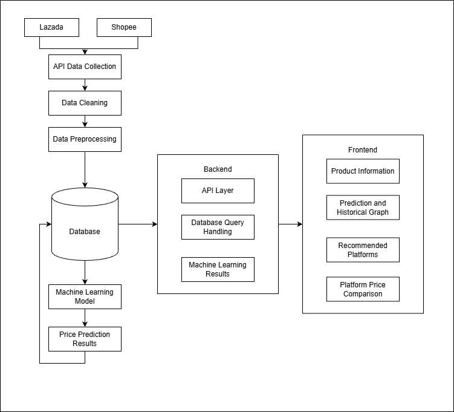
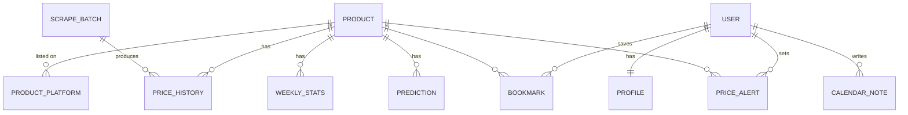

# PricePulse architecture

This is a high-level overview of how PricePulse is built. It describes components and
design decisions without exposing implementation code, credentials or deployment details.

## System overview

| Stage | What happens |
|---|---|
| Lazada, Shopee | Source marketplaces for phone and tablet listings |
| API data collection | Managed scraper actors return listing data through an API, with token rotation across runs |
| Data cleaning | Normalises titles, prices and specs, and removes duplicates and accessories |
| Data preprocessing | Matches listings to canonical products and aggregates them into weekly statistics and features |
| Database | MySQL holds products, listings, price history, weekly statistics, predictions and user data |
| Machine learning model | Reads weekly statistics and predicts next week's price trend |
| Price prediction results | Written back to the database with confidence and model version |
| Backend | Django API layer, database query handling (cached in Redis), and access to ML results |
| Frontend | Product information, prediction and historical graph, recommended platforms, platform price comparison |

## Components

| Component | Responsibility |
|---|---|
| Web app | Server-rendered pages for search, product detail, bookmarks, calendar, analytics, profile and a staff panel. Page-specific JavaScript modules fetch JSON and render charts. |
| REST API | Products, price history, weekly stats, predictions, bookmarks, alerts, profile and on-demand scrape jobs. Used by the mobile app and by the web pages. |
| Mobile app | React Native (Expo) client with JWT login, token refresh, dashboard, search, bookmarks and profile. |
| Pipeline | Four phases: scrape and clean, weekly aggregation, prediction, database load. Every run is recorded as a batch with status and timings. |
| Task queue | Celery workers handle the weekly pipeline, single-product refreshes, model retraining, dashboard pre-computation and alert emails. Celery beat holds the schedule. |
| Cache | Redis serves as the Celery broker and the Django cache for expensive dashboard and search queries. |

## Key design decisions

| Decision | Why |
|---|---|
| Two auth modes (sessions for web, JWT for mobile) | The web app benefits from Django sessions and CSRF protection. The mobile app needs stateless tokens it can refresh. |
| Pipeline-owned tables are unmanaged by Django | The pipeline writes product, price and statistics tables in bulk. Keeping them outside Django migrations avoids schema conflicts between the two writers. User-facing tables such as profiles, bookmarks, alerts and notes are regular Django models. |
| Canonical product key | Each marketplace titles the same phone differently. Cleaners extract brand, model, RAM and storage into a canonical key so listings from all platforms land on one product. |
| Weekly granularity | Daily prices are noisy and scraping costs grow with frequency. Weekly aggregates keep the signal and match how people plan purchases around sale events. |
| Managed scraper actors | Hosted actors handle JavaScript rendering, proxies and anti-bot measures. API tokens are rotated across runs to spread quota usage. |
| Versioned models | Each training run is saved as a new version. Staff can switch the active version or roll back without retraining. |
| Alerts after load | Alerts are evaluated only after a successful database load, so a partial or failed scrape never triggers a false alert. |

## Data model (simplified)

| Entity | Notes |
|---|---|
| Product | Canonical product with brand, category, RAM and storage |
| Product platform | A product's listing on one marketplace, with URL and latest price |
| Price history | One observed price per listing per scrape batch |
| Weekly stats | Per-product weekly aggregates and engineered features |
| Prediction | Next-week trend, confidence and model version |
| Scrape batch | One pipeline run with status, counts and timings |
| Profile, bookmark, alert, note | User-owned data managed by Django |

## Security measures

- Secrets come from environment variables and are never committed.
- Login attempts are rate-limited and locked out after repeated failures.
- API endpoints are throttled per user and per anonymous client.
- Staff-only views and endpoints are permission-checked on the server.
- The database is never exposed on a public port.
- The web app runs behind an Nginx reverse proxy.

## Deployment

The system is packaged as a Docker Compose stack (web, Celery worker, Celery beat, MySQL,
Redis, Nginx). Configuration differs per environment and is supplied through an environment
file that is not part of the repository.
