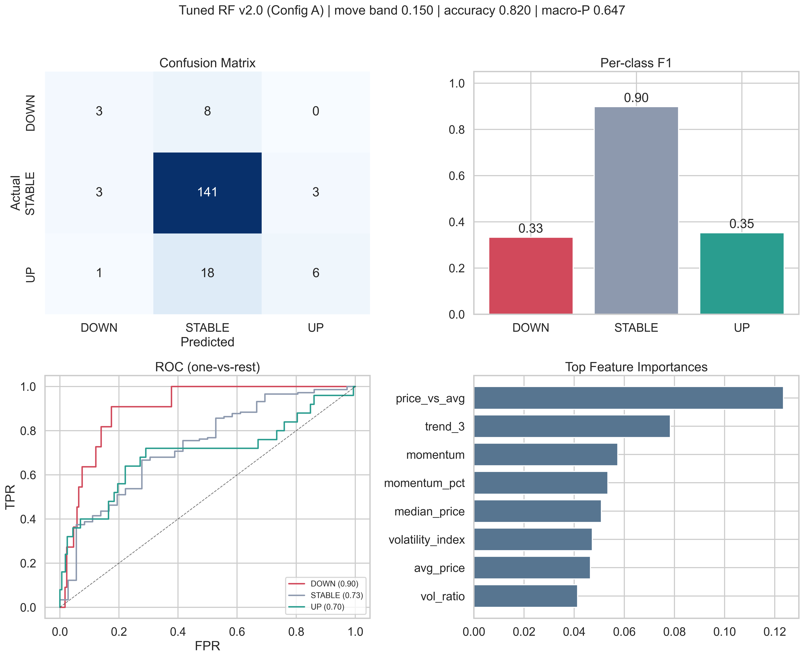

# Trend prediction model

PricePulse predicts whether a product's lowest price will go **UP**, go **DOWN** or stay
**STABLE** next week. This page covers the problem framing, the model and an honest
evaluation.

## Problem framing

- **Unit:** one product in one ISO week.
- **Target:** next week's week-over-week change in the lowest price, bucketed by a move band.

```text
UP      if next_change >  band
DOWN    if next_change < -band
STABLE  otherwise
```

The band is chosen automatically on each training run. Candidate bands are evaluated, and
the most accurate one is kept on one condition: UP and DOWN must each still make up at least
8% of the labels. Without that guard the "best" band would simply make almost everything
STABLE.

## Features

28 features are computed from weekly aggregates:

| Group | Examples |
|---|---|
| Price levels | average, min, max and median price |
| Lags | previous one and two weeks' prices, previous change |
| Rolling | 3-week mean, 3-week standard deviation, 3-week trend |
| Momentum | momentum, momentum %, price acceleration |
| Relative position | price vs. own average, price vs. median, category z-score |
| Volatility | volatility index, volatility ratio, range % |
| Market activity | listing count, change in listing count |
| Regime | stable-zone flag, anomaly flag, consecutive trend weeks, trend consistency |

The most important features in practice are price relative to its own average, the 3-week
trend and momentum.

## Model

A single Random Forest with class-balanced bootstrap samples, shallow trees and a minimum
leaf size, to resist overfitting on a small dataset. Oversampling (SMOTE) was tried and
dropped, because balanced class weights did better on every metric.

A confidence-threshold wrapper changes a predicted UP or DOWN to STABLE when the model is not
confident enough. The threshold is tuned on each run to maximise accuracy, subject to macro
precision of at least 0.50 and all three classes still being predicted.

## Evaluation

### Walk-forward comparison

Expanding-window walk-forward evaluation: train on all weeks before *t*, predict week *t*,
then move forward. No future data reaches training.

| Model | Accuracy | Macro F1 |
|---|---|---|
| Always STABLE (baseline) | 0.76 | 0.29 |
| SVM | 0.709 | 0.291 |
| Random Forest, default | 0.712 | 0.360 |
| XGBoost, default | 0.706 | 0.392 |
| **PricePulse v2.0** | 0.677 | **0.432** |

**How to read this.** About three quarters of product-weeks are STABLE, so a model that
never predicts a move already scores 76% accuracy. None of the models beat that baseline on
accuracy. PricePulse v2.0 gives up a few points of accuracy and gets the best macro F1,
because it is the only model that makes a real attempt to catch UP and DOWN moves.

### Single held-out split

The chart below comes from one per-product time split with a wider band. Under that setup
the classes are even more STABLE-heavy, and accuracy looks high (0.82) for the same reason as
above. The confusion matrix shows the real difficulty: most true UP and DOWN weeks are
predicted as STABLE.



## Lessons learned

- **Pick the metric before the model.** With imbalanced classes, accuracy rewards doing
  nothing. Macro F1 and per-class recall show whether the model is useful.
- **The label definition is the biggest lever.** Changing the move band changed results more
  than any change of algorithm, ensemble, calibration or extra feature.
- **Evaluate the way the model is used.** Single random splits gave optimistic numbers.
  Walk-forward evaluation matches how predictions are made in production.
- **Data volume is the ceiling.** With only a few months of weekly history, the directional
  signal is weak. More weeks of data will help more than more modelling.

## Operations

- Each training run is saved as a new model version, with its metrics and chosen band.
- The weekly pipeline retrains and re-scores automatically.
- From the staff panel, staff can re-score without retraining, retrain and deploy, switch the
  active version, roll back, or correct a single prediction.
